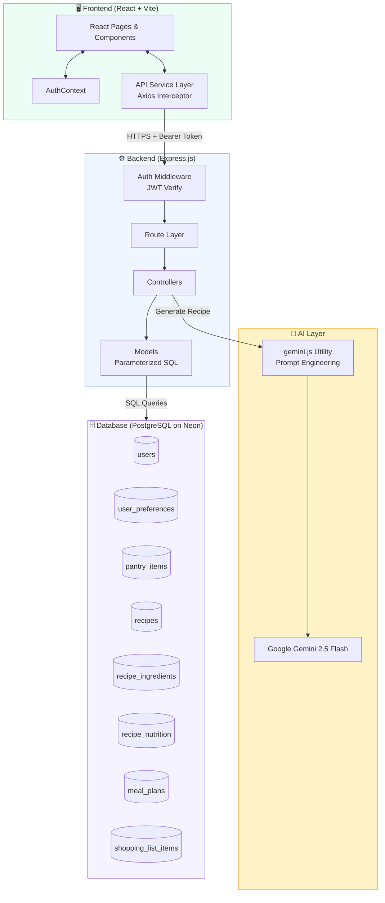
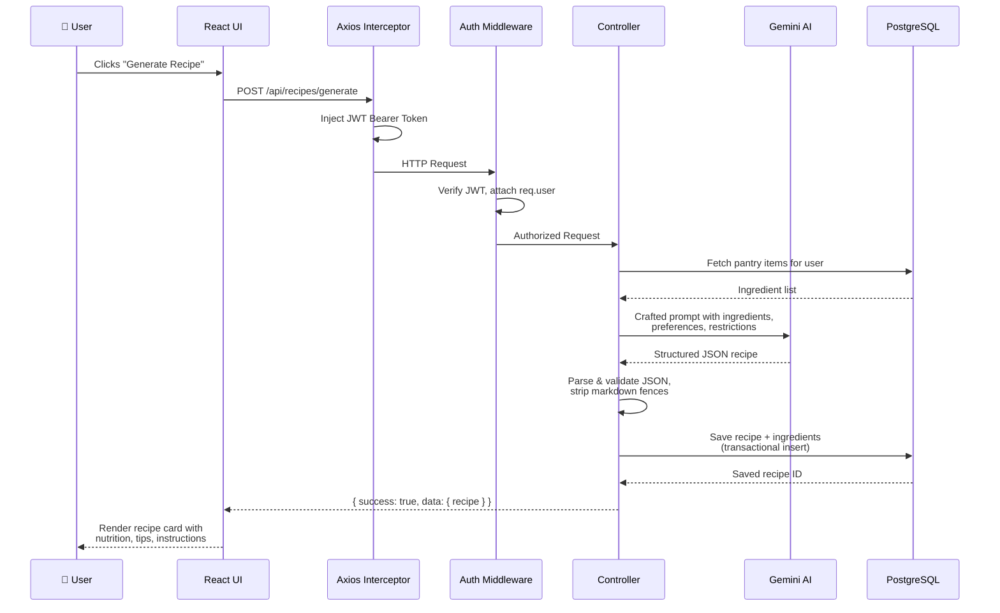

<div align="center">

# 🍽️ AI Recipe Generator

### *Your intelligent cooking companion — from pantry to plate*

[](https://ai-recipe-generator-self.vercel.app/)
[](https://github.com/Saket22-CS/AI-Recipe-Generator.git)
[](LICENSE)
[](https://nodejs.org)
[](https://react.dev)
[](https://neon.tech)
[](https://ai.google.dev)

---

*A full-stack PERN application that uses Google Gemini AI to generate personalized recipes from your pantry ingredients — complete with meal planning, shopping lists, and nutritional insights.*

[**View Live →**](https://ai-recipe-generator-self.vercel.app/) · [**Report Bug**](https://github.com/Saket22-CS/AI-Recipe-Generator/issues) · [**Request Feature**](https://github.com/Saket22-CS/AI-Recipe-Generator/issues)

</div>

---

## 🌟 Overview

AI Recipe Generator is a **production-grade, full-stack cooking assistant** that bridges the gap between what's in your fridge and what's on your dinner table. Powered by **Google Gemini 2.5 Flash**, it intelligently generates recipes tailored to your available ingredients, dietary restrictions, cuisine preferences, and time constraints.

Built on the **PERN stack** (PostgreSQL, Express.js, React, Node.js) with a serverless database hosted on **Neon**, the app handles everything from authentication to AI-powered meal planning in a clean, responsive interface.

> **What makes it different?** Unlike static recipe databases, this app generates *novel, personalized recipes on demand* — and connects them directly to your pantry inventory, weekly meal schedule, and grocery list in one unified workflow.

---

## ✨ Features

### 🔐 Authentication & Profiles
- Secure registration and login with email/password
- Passwords hashed with **bcrypt** (salt rounds: 12)
- **JWT tokens** with 30-day expiry for stateless auth
- Full profile management: update name, email, dietary preferences
- Account deletion with cascading data removal and double confirmation

### 🥦 Smart Pantry Management
- Add, edit, and delete pantry items with categories (vegetables, dairy, meats, grains, etc.)
- Expiry date tracking with **visual alerts for items expiring within 7 days**
- Low-stock flags and quantity management
- Sortable and filterable item list by category or expiry
- Pantry stats dashboard (total items, expiring soon, categories)

### 🤖 AI Recipe Generation
- Generate recipes from **pantry items** or **manual ingredient input**
- Select from 10+ cuisine types (Italian, Mexican, Indian, Asian, Mediterranean, etc.)
- Apply dietary restrictions: vegetarian, vegan, gluten-free, keto, paleo, dairy-free
- Adjust **serving size** and **cooking time preference** (quick / medium / long)
- Each AI-generated recipe includes:
  - Name, description, cuisine, and difficulty rating
  - Dietary badges and allergen info
  - Full ingredients list with precise quantities
  - Step-by-step numbered cooking instructions
  - Complete nutrition facts (calories, protein, carbs, fats, fiber)
  - Personalized AI cooking tips

### 📚 Recipe Collection
- Save generated recipes to your personal collection
- **Search and filter** by cuisine, difficulty, or dietary tag
- Adjustable serving size on the recipe detail page (scales all ingredient quantities)
- Delete recipes with confirmation

### 📅 Meal Planner
- Weekly **calendar grid** view (Mon–Sun × Breakfast/Lunch/Dinner)
- Assign saved recipes to any meal slot
- Real-time add/delete with visual feedback
- Weekly meal stats and upcoming meal preview on the dashboard
- **Upsert-based backend** ensures idempotent meal assignment

### 🛒 Smart Shopping List
- **Auto-generate** a consolidated grocery list from your weekly meal plan
- Ingredients from multiple recipes are **merged and summed** by category
- Manually add items not in any recipe
- Check off purchased items; bulk-add checked items back to pantry
- Supports clear-checked and clear-all operations
- Items grouped by category for efficient grocery shopping

### ⚙️ User Preferences & Settings
- Set default dietary restrictions and cuisine preferences
- Default serving size pre-fills the recipe generator
- Secure password change with current password validation
- Preference sync across all app features

---

## 🛠 Tech Stack

| Layer | Technology | Purpose |
|-------|-----------|---------|
| **Frontend** | React 19 + Vite | Fast SPA with HMR |
| **Styling** | Tailwind CSS v4 | Utility-first responsive UI |
| **Routing** | React Router v6 | Client-side navigation |
| **HTTP Client** | Axios + Interceptors | JWT injection, error handling |
| **State** | React Context API | Global auth state |
| **Backend** | Node.js + Express.js | REST API server |
| **Database** | PostgreSQL (Neon) | Relational data, serverless |
| **ORM** | Raw SQL with `pg` | Parameterized, safe queries |
| **Auth** | JWT + bcrypt.js | Stateless, secure auth |
| **AI** | Google Gemini 2.5 Flash | Recipe generation |
| **Dev Tools** | Nodemon, ESLint | Auto-reload, code quality |

---

## 🏗 System Architecture



---

## 🔄 Request Lifecycle



---

## 📁 Project Structure

```
ai_recipe_gen/
│
├── backend/
│   ├── config/
│   │   ├── db.js                  # PostgreSQL connection pool
│   │   └── schema.sql             # Full database schema
│   │
│   ├── controllers/
│   │   ├── authController.js      # Signup, login, token management
│   │   ├── userController.js      # Profile, preferences, password
│   │   ├── pantryController.js    # Pantry CRUD + expiry alerts
│   │   ├── recipeController.js    # AI generation + recipe CRUD
│   │   ├── mealPlanController.js  # Calendar meal assignments
│   │   └── shoppingListController.js  # List gen + pantry sync
│   │
│   ├── middleware/
│   │   └── auth.js                # JWT verification middleware
│   │
│   ├── models/
│   │   ├── User.js                # User queries + bcrypt
│   │   ├── UserPreference.js      # Preference CRUD
│   │   ├── PantryItem.js          # Pantry queries + filtering
│   │   ├── Recipe.js              # Transactional recipe save
│   │   ├── MealPlan.js            # Upsert meal assignments
│   │   └── shoppingList.js        # List + pantry sync queries
│   │
│   ├── routes/
│   │   ├── auth.js                # /api/auth/*
│   │   ├── users.js               # /api/users/*
│   │   ├── pantry.js              # /api/pantry/*
│   │   ├── recipes.js             # /api/recipes/*
│   │   ├── mealPlan.js            # /api/meal-plans/*
│   │   └── shoppingList.js        # /api/shopping-list/*
│   │
│   ├── utils/
│   │   └── gemini.js              # Gemini AI prompt utils
│   │
│   ├── server.js                  # Express app entry point
│   └── migrate.js                 # DB schema migration runner
│
└── frontend/
    └── src/
        ├── components/
        │   ├── Navbar.jsx         # Top nav with profile dropdown
        │   └── ProtectedRoute.jsx # Auth guard for private routes
        │
        ├── context/
        │   └── AuthContext.jsx    # Global auth state + localStorage
        │
        ├── pages/
        │   ├── Login.jsx          # Auth flow
        │   ├── SignUp.jsx
        │   ├── Dashboard.jsx      # Stats + recent recipes + meals
        │   ├── Pantry.jsx         # Ingredient management
        │   ├── RecipeGenerator.jsx # AI recipe UI
        │   ├── MyRecipes.jsx      # Recipe collection
        │   ├── RecipeDetail.jsx   # Full recipe with scaling
        │   ├── MealPlanner.jsx    # Weekly calendar
        │   ├── ShoppingList.jsx   # Grocery list
        │   └── Settings.jsx       # Profile + preferences
        │
        └── services/
            └── api.js             # Centralized Axios instance
```

---

## 🗄 Database Schema

The schema uses **UUID primary keys**, **JSONB** for instructions, **PostgreSQL arrays** for dietary data, and **triggers** for automatic `updated_at` timestamps.

```sql
-- Core entities (simplified)

users                    -- id (UUID), email, password_hash, name
user_preferences         -- user_id → cuisines[], dietary_restrictions[]
pantry_items             -- user_id, name, quantity, unit, category, expiry_date
recipes                  -- user_id, name, cuisine, difficulty, instructions (JSONB)
recipe_ingredients       -- recipe_id, name, quantity, unit
recipe_nutrition         -- recipe_id, calories, protein, carbs, fat, fiber
meal_plans               -- user_id, recipe_id, date, meal_type (UNIQUE constraint)
shopping_list_items      -- user_id, name, quantity, category, is_checked
```

**Key design decisions:**
- Recipes use a **normalized structure** (separate tables for ingredients and nutrition) for flexible querying and serving-size scaling
- `instructions` stored as **JSONB array** of step objects for efficient retrieval and ordering
- `meal_plans` uses **UNIQUE(user_id, date, meal_type)** with upsert to prevent duplicate assignments
- **Cascade deletes** on all user-linked tables ensure clean account removal
- **Indexes** on `user_id`, `expiry_date`, and `is_checked` for query performance

---

## 📡 API Reference

All protected endpoints require: `Authorization: Bearer <token>`

All responses follow:
```json
{
  "success": true,
  "message": "Human-readable status",
  "data": { ... }
}
```

### Auth — `/api/auth`
| Method | Endpoint | Auth | Description |
|--------|----------|------|-------------|
| `POST` | `/signup` | ❌ | Register new user |
| `POST` | `/login` | ❌ | Login, receive JWT |
| `POST` | `/reset-password` | ❌ | Password reset (placeholder) |
| `GET` | `/me` | ✅ | Get authenticated user |

### Users — `/api/users`
| Method | Endpoint | Auth | Description |
|--------|----------|------|-------------|
| `GET` | `/profile` | ✅ | Profile + preferences |
| `PUT` | `/profile` | ✅ | Update name/email |
| `PUT` | `/preferences` | ✅ | Update dietary prefs |
| `PUT` | `/change-password` | ✅ | Secure password change |
| `DELETE` | `/account` | ✅ | Delete account + all data |

### Recipes — `/api/recipes`
| Method | Endpoint | Auth | Description |
|--------|----------|------|-------------|
| `POST` | `/generate` | ✅ | **AI recipe generation** |
| `GET` | `/suggestions` | ✅ | Pantry-based ideas |
| `GET` | `/` | ✅ | List recipes (filterable) |
| `GET` | `/recent` | ✅ | Recent recipes |
| `GET` | `/stats` | ✅ | Recipe statistics |
| `GET` | `/:id` | ✅ | Full recipe detail |
| `POST` | `/` | ✅ | Save recipe |
| `PUT` | `/:id` | ✅ | Update recipe |
| `DELETE` | `/:id` | ✅ | Delete recipe |

### Pantry — `/api/pantry`
| Method | Endpoint | Auth | Description |
|--------|----------|------|-------------|
| `GET` | `/` | ✅ | List items (filter by category) |
| `GET` | `/stats` | ✅ | Pantry statistics |
| `GET` | `/expiring-soon` | ✅ | Items expiring in `?days=7` |
| `POST` | `/` | ✅ | Add pantry item |
| `PUT` | `/:id` | ✅ | Update item |
| `DELETE` | `/:id` | ✅ | Delete item |

### Meal Plans — `/api/meal-plans`
| Method | Endpoint | Auth | Description |
|--------|----------|------|-------------|
| `GET` | `/weekly` | ✅ | Week view `?start_date=YYYY-MM-DD` |
| `GET` | `/upcoming` | ✅ | Next N meals `?limit=5` |
| `GET` | `/stats` | ✅ | Meal plan stats |
| `POST` | `/` | ✅ | Assign meal (upsert) |
| `DELETE` | `/:id` | ✅ | Remove meal assignment |

### Shopping List — `/api/shopping-list`
| Method | Endpoint | Auth | Description |
|--------|----------|------|-------------|
| `GET` | `/` | ✅ | List items (`?grouped=true`) |
| `POST` | `/generate` | ✅ | Auto-generate from meal plan |
| `POST` | `/` | ✅ | Add manual item |
| `PUT` | `/:id` | ✅ | Update item |
| `PUT` | `/:id/toggle` | ✅ | Toggle checked status |
| `DELETE` | `/:id` | ✅ | Remove item |
| `DELETE` | `/clear/checked` | ✅ | Remove all checked |
| `DELETE` | `/clear/all` | ✅ | Clear entire list |
| `POST` | `/add-to-pantry` | ✅ | Sync checked → pantry |

---

## 🚀 Getting Started

### Prerequisites

- **Node.js** v18 or higher
- **npm** v9+
- A **PostgreSQL** database (free tier at [neon.tech](https://neon.tech) recommended)
- A **Google Gemini API key** from [Google AI Studio](https://aistudio.google.com)

### 1. Clone the Repository

```bash
git clone https://github.com/Saket22-CS/AI-Recipe-Generator.git
cd AI-Recipe-Generator
```

### 2. Backend Setup

```bash
cd backend
npm install
```

Create `backend/.env` (see [Environment Variables](#-environment-variables)), then:

```bash
# Run database migrations
node migrate.js

# Start development server
npm run dev
# → API running at http://localhost:8000/api
```

### 3. Frontend Setup

```bash
cd ../frontend
npm install
```

Create `frontend/.env`:
```env
VITE_API_URL=http://localhost:8000/api
```

```bash
npm run dev
# → App running at http://localhost:5173
```

---

## 🔐 Environment Variables

### `backend/.env`

```env
# Server
PORT=8000
NODE_ENV=development

# Database (get from neon.tech dashboard)
DATABASE_URL=postgresql://<user>:<password>@<host>/<db>?sslmode=require

# Auth (generate a long random string)
JWT_SECRET=your_super_secret_jwt_key_min_32_chars

# AI
GEMINI_API_KEY=your_google_gemini_api_key
```

### `frontend/.env`

```env
VITE_API_URL=http://localhost:8000/api
```

> ⚠️ **Never commit `.env` files.** Both are listed in `.gitignore`.

---

## 🤖 AI Integration

The AI layer lives in `backend/utils/gemini.js` and exposes three core functions:

### `generateRecipe(options)`
Constructs a detailed prompt including ingredients, cuisine, dietary restrictions, servings, and cooking time. Requests a strictly-typed JSON response from Gemini 2.5 Flash.

**Prompt strategy:**
```
You are a professional chef. Generate a recipe using these ingredients: [list].
Requirements: [cuisine], [restrictions], [servings], [time].
Return ONLY valid JSON with this exact schema: { name, description, cuisine, difficulty, 
dietary, ingredients: [{name, quantity, unit}], instructions: [{step, description}], 
nutrition: {calories, protein, carbs, fat, fiber}, tips }
```

**Robust parsing pipeline:**
1. Strip markdown code fences (` ```json ... ``` `)
2. `JSON.parse()` the cleaned response
3. Validate required fields exist
4. Fallback: return structured error object (no crash)

### `getRecipeSuggestions(pantryItems)`
Prioritizes ingredients with the nearest expiry dates in the prompt, helping reduce food waste intelligently.

### `getCookingTips(recipeName)`
Returns contextual cooking advice for a specific dish.

---

## 🔒 Security

- **Password hashing** — bcrypt with 12 salt rounds
- **JWT authentication** — tokens signed with a secret, verified on every protected route
- **SQL injection prevention** — all queries use parameterized statements via `pg`
- **Route protection** — middleware validates token and attaches `req.user` before any controller runs
- **Input validation** — request bodies validated in controllers before DB operations
- **Cascade deletes** — deleting an account wipes all associated data atomically

---

## ⚡ Performance

- **Parallel API calls** on the Dashboard — recipe stats, pantry stats, recent recipes, and upcoming meals fetched concurrently with `Promise.all()`
- **Database indexes** on high-frequency query fields (`user_id`, `expiry_date`, `is_checked`)
- **Optimistic UI updates** — delete operations update UI instantly without waiting for server confirmation
- **Neon serverless PostgreSQL** — scales to zero when idle, auto-scales under load
- **Vite build tool** — sub-second HMR in development, optimized production bundles

---

## 🗺 Future Roadmap

| Feature | Status |
|---------|--------|
| AI-generated recipe images | 🔜 Planned |
| Social recipe sharing | 🔜 Planned |
| Voice assistant (hands-free cooking mode) | 🔜 Planned |
| Nutritional analytics & weekly insights | 🔜 Planned |
| Push notifications for expiring items | 🔜 Planned |
| Offline support (PWA) | 🔜 Planned |
| Mobile app (React Native) | 🔜 Planned |
| Recipe import from URLs | 🔜 Planned |
| Multi-user household pantry sharing | 💡 Idea |

---

## 🤝 Contributing

Contributions are welcome! Here's how:

1. **Fork** the repository
2. **Create** a feature branch: `git checkout -b feature/your-feature-name`
3. **Commit** your changes: `git commit -m 'feat: add your feature'`
4. **Push** to the branch: `git push origin feature/your-feature-name`
5. **Open** a Pull Request

Please follow the existing code style and include tests for new features where applicable.

---

## 📄 License

This project is licensed under the **MIT License** — see the [LICENSE](LICENSE) file for details.

---

<div align="center">

**Built with ❤️ by [Saket22-CS](https://github.com/Saket22-CS)**

*If you found this project useful, please consider giving it a ⭐ on GitHub!*

</div>